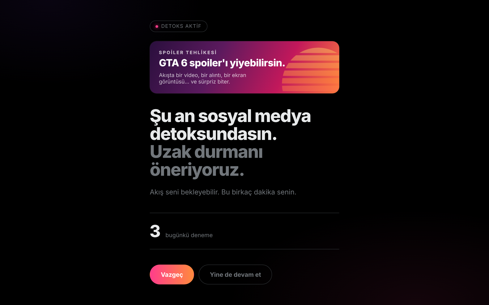
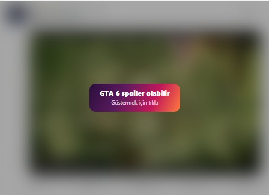

# Sosyal Medya Detoksu 🌴

x.com'a girmeden önce seni durduran, akıştaki **GTA 6 spoiler'larını** bulanıklaştıran küçük bir Chrome/Edge eklentisi.

  

## Ne yapıyor?

**1. Detoks uyarısı**
x.com'u (ve twitter.com'u) açtığında sayfa yüklenmeden önce karanlık bir uyarı ekranı çıkar:
> Şu an sosyal medya detoksundasın. Uzak durmanı öneriyoruz.

- **Vazgeç** → sekme kapanır.
- **Yine de devam et** → x.com o sekmede, sekme kapanana kadar açılır.
- Ekranda o gün kaç kez girmeye çalıştığın sayılır.

**2. GTA 6 spoiler kalkanı**
Akışta GTA 6 ile ilgili bir tweet geçerse bulanıklaştırılır, üzerinde hesabın adı ve “GTA 6 spoiler olabilir — göstermek için tıkla” etiketi görünür.

  

Yakalanan kelimeler:
- Oyun: `GTA 6`, `GTA6`, `GTA VI`, `Grand Theft Auto 6`, `#GTA6`
- Karakterler: Lucia, Jason, Duval, Caminos, Cal Hampton, Boobie Ike, Dre'Quan, Real Dimez, Bae-Luxe, Raul Bautista, Brian Heder
- Mekânlar: Vice City, Leonida, Port Gellhorn, Grassrivers, Kalaga

Görsellerin alt metinleri de taranır. Kendi kelimelerini eklemek için `content.js` içindeki `GTA_TERMS` listesini düzenlemen yeterli.

## Kurulum

1. Bu repoyu indir (**Code → Download ZIP**) ve bir klasöre çıkar.
2. Chrome'da `chrome://extensions`, Edge'de `edge://extensions` adresini aç.
3. Sağ üstten **Geliştirici modu**nu aç.
4. **Paketlenmemiş öğe yükle** → çıkardığın klasörü seç.

## Açma / kapatma

Eklenti ikonuna tıkla; iki ayrı anahtar var:
- **x.com uyarısı**
- **GTA 6 tweet bulanıklaştırma**

Tamamen kaldırmak için `chrome://extensions` → *Sosyal Medya Detoksu* → **Kaldır**.

## Dosyalar

| Dosya | Görevi |
|---|---|
| `manifest.json` | Eklenti tanımı (Manifest V3) |
| `background.js` | x.com yönlendirmesi ve “devam et” izni |
| `warning.html` / `warning.js` | Detoks uyarı ekranı |
| `content.js` / `content.css` | GTA 6 tweet bulanıklaştırma |
| `popup.html` / `popup.js` | Açma/kapatma menüsü |

## Gizlilik

Hiçbir veri dışarı gönderilmez. Her şey tarayıcında çalışır; sadece günlük deneme sayısı ve ayarlar `chrome.storage.local` içinde tutulur.

---
Rockstar Games veya X ile bir bağlantısı yoktur.
